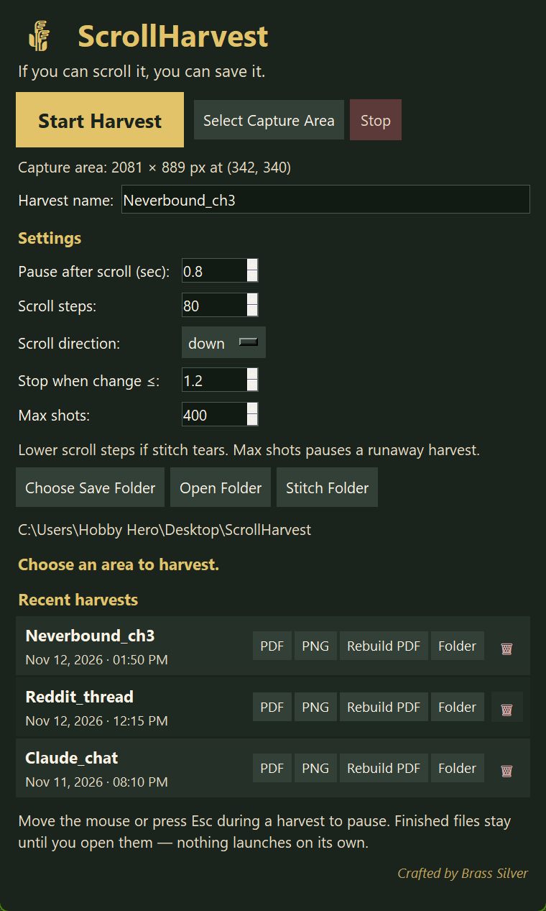

# ScrollHarvest

**If you can scroll it, you can save it.**

ScrollHarvest is a small Windows app that saves anything you can scroll — a long chapter, a chat conversation, a Reddit thread, an illustrated book page — as one continuous PNG and a paged PDF. It's for apps and sites that don't offer a useful export.



## What it does

- You draw a box around the content once; ScrollHarvest remembers it for next time.
- It takes a screenshot, scrolls a little, and repeats until the page stops changing.
- It stitches the screenshots into one seamless image. Sticky headers, floating message bars, and fade-out edges are detected and left out, so you don't get repeated bars or sliced lines of text.
- It also makes a PDF with clean page breaks that never cut through a line of text or an illustration, with page margins and a small "Page X of N" footer.
- Everything stays on your computer. Nothing is uploaded.

## Install

**Easiest:** download `ScrollHarvest.exe` from the [Releases](https://github.com/witchofthehill-glitch/ScrollHarvest/releases/latest) page and double-click it. No Python or installer needed — it's a single file you can keep anywhere.

**"Windows protected your PC"?** Windows shows this blue warning for any downloaded app that isn't code-signed, which costs money every year, so most free tools aren't. Click **More info**, then **Run anyway**. Some antivirus tools also flag apps packaged this way; the full source code is right here if you'd rather run it yourself.

**From source:** install Python 3.10 or newer, then:

```bash
pip install -r requirements.txt
python scrollharvest.py
```

You can also double-click `ScrollHarvest.bat`.

## How to use it

1. Click **Select Capture Area** and drag a box around the content. Press **Esc** to cancel. Next time the box comes back as a gold outline — press **Enter** to keep it, or drag its edges to adjust.
2. Optionally type a **Harvest name** (for example `Neverbound_ch3`).
3. Choose **down** for most pages, or **up** for chat apps that load older messages above.
4. Click **Start Harvest**, then click the page you want saved within 3 seconds.
5. Let it run. It stops by itself when the page stops changing.

While it's running:

- **Move the mouse** or press **Esc** to pause. Then pick **Continue**, **Finish & Save** (stitch what you have), or **Discard** (throw this harvest away).
- At **Max shots** (400 by default) it pauses so a page that never stops changing can't run forever.

When it's done, use **Open PDF**, **Open PNG**, or **Open Folder**. Nothing opens by itself.

### Recent harvests

Each recent harvest has **PDF**, **PNG**, **Rebuild PDF** (remake the PDF from the saved image), **Folder**, and 🗑. The trash button moves the whole harvest to the Recycle Bin, so you can restore it if you change your mind.

Harvests are saved in `Desktop\ScrollHarvest\YourName_YYYYMMDD_HHMMSS\`.

## Tips

- If lines look torn or doubled, lower **Scroll steps** (default 80).
- If a harvest never stops (typing indicators, GIFs, clocks), raise **Stop when change ≤**, or press **Esc** and choose **Finish & Save**.
- Keep the capture box tight around the content, but don't cut through letters at the edges.

## Building the .exe

Run `build_exe.bat`. It installs PyInstaller if needed, writes `dist\ScrollHarvest.exe` (a single ~22 MB file), and installs it to `%LOCALAPPDATA%\Programs\ScrollHarvest\`. Close ScrollHarvest first so the installed copy can be replaced. Technical notes and the release testing checklist are in `DEVELOPMENT_NOTES.md`.

## Limits

Some apps scroll in unusual steps, animate or lazy-load content, or block screenshots. Those may need adjustments. ScrollHarvest is Windows-only.

## Privacy

All screenshots and files stay on your computer unless you move or upload them yourself.

## Please use it fairly

ScrollHarvest is meant for keeping a personal copy of things you can already read. Only save content you have the right to keep, respect each site's terms, and don't redistribute other people's writing or art without their permission.

## License

MIT — see `LICENSE.txt`. Crafted by Brass Silver.
